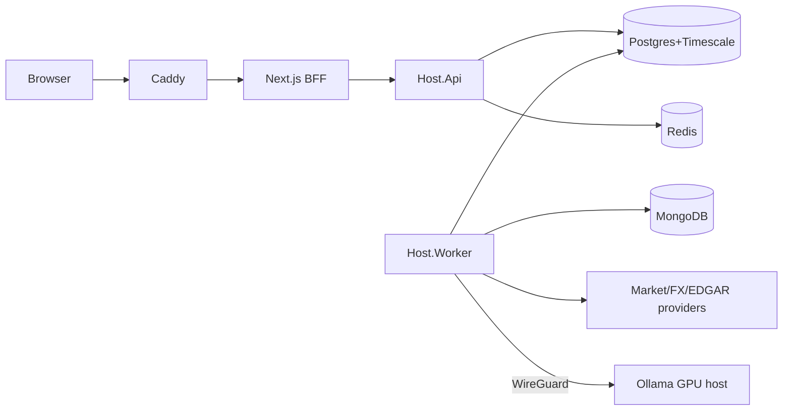

# RFC-0001 — Saker Watch design doc

- **Purpose:** goals, architecture, data model, flows, failure modes, rollout.
- **Owner:** Eder · **Status:** draft · **Target phase:** 0

## Goals
Watchlist with multi-window performance; USD→GTQ + partial-share calculator; nightly shared LLM analysis with deterministic signal; retention policy; multi-user ready by design.

## Non-goals
Trading, broker connectivity, real-time tick data, financial advice, mobile native apps.

## Architecture
See ADR-0003/0004. Modular monolith, `Host.Api` + `Host.Worker`, Postgres(+Timescale) / Mongo / Redis, separate Ollama host over WireGuard.

## Data model (ERD summary)
`identity.users` ← `watchlist.watchlist_items` → `marketdata.stocks` ← `marketdata.price_daily/intraday`; `analysis.prompt_templates` ← `analysis.analysis_runs` → `analysis.analysis_results` → `signals.signals`; `platform.{idempotency_keys,outbox_messages,job_queue,audit_log}`. Details: master prompt §3.

## Sequence: daily ingestion
Scheduler (Quartz, market-calendar aware) → enqueue `ingest:{date}` (unique) → Worker leases job → provider call (Polly, Redis token bucket) → raw payload to Mongo → upsert `price_daily ON CONFLICT` → outbox `PricesIngested` → performance cache invalidated.

## Sequence: analysis
Schedule/on-demand → enqueue `analysis:{stock}:{promptVer}:{date}` → ContextBuilder (source+as_of) → Mongo `analysis_context` → ILlmAnalyzer (concurrency limited) → JSON-schema validate (+1 repair) → Mongo (deterministic `_id`) → Postgres row + outbox in one tx → Signals engine.

## Failure modes
Provider down/slow → serve last price with `stale_since`; LLM down → runs stay `pending` with backoff; Mongo unavailable mid-pipeline → job retries, janitor cleans orphans; worker killed → lease expires and job is redelivered; JWKS rotation → refresh on unknown `kid`.

## Rollout
Phases 0–6 with hard gates (master prompt §12). Single user first; multi-user gated on provider licensing.

## Open questions
Clavaris contract; LLM hardware; other exchanges; rounding confirmation. See `assumptions.md`.
