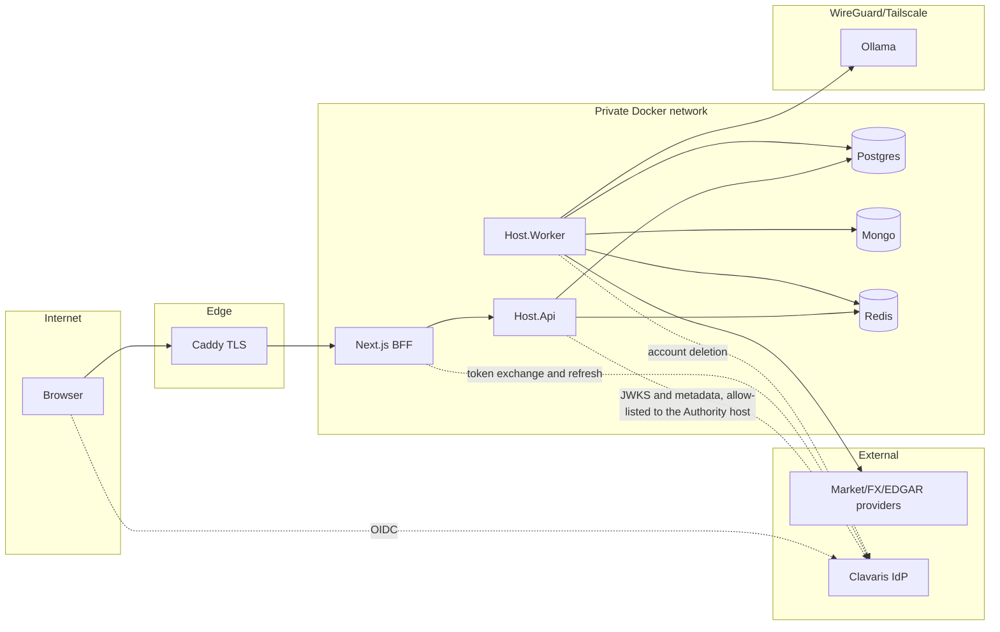

# Threat model v1 (STRIDE)

- **Purpose:** identify threats per trust boundary and track mitigations. Updated every phase.
- **Owner:** Eder · **Status:** approved · **Target phase:** 0 (updated each phase)

## Data-flow diagram

Trust boundaries: TB1 browser↔edge, TB2 edge↔app, TB3 app↔datastores, TB4 app↔LLM, TB5 app↔external providers/IdP.

## STRIDE
| ID | Boundary | Threat | Mitigation | Status |
|---|---|---|---|---|
| T1 | TB1 | **S**poofing: forged/replayed JWT | RS256 only (checked before any key lookup), signing keys from the discovered JWKS, exact issuer, required audience, lifetime with injected clock and skew capped at 60 s, ID tokens and `act` tokens refused (T24), token length cap; unknown `kid` triggers one awaited refresh per 30 s; when the provider is unreachable the last known keys are served for at most `MaximumKeyAge` (24 h) and then validation fails closed, so a provider outage is neither a lock-out nor an unbounded trust in a withdrawn key (event 9603) | mitigated P1 |
| T2 | TB1 | **T**ampering: mass assignment / injected ticker | Validators on every command (locale allow-list, key format), strict binding, body cap (T27); ticker allow-list is `Ticker.Create` and `Mic.Create`, applied by every command that takes a market or ticker | mitigated P2 |
| T3 | TB2 | **R**epudiation: untraceable security events | Append-only `platform.audit_log` (triggers reject UPDATE/DELETE/TRUNCATE), hash chain verified by `verify_audit_chain`, actor stored as an HMAC pseudonym, entry written in the same transaction as the change, correlation id. The chain is tamper-evident, not tamper-proof: the table owner or a superuser can disable the triggers, and truncating the tail is undetectable without an external anchor (the head hash and count are not yet recorded outside the database; planned P5) | mitigated P1; anchor P5 |
| T4 | TB3 | **I**nfo disclosure: cross-user data read (IDOR) | Postgres RLS on user-owned tables keyed on `app.current_user_id` (set from the validated principal on every connection open; empty means no rows), minimal grants, isolation tests; the user id never comes from client input. RLS is `ENABLE` without `FORCE` by design: the runtime roles own no tables and the security-definer functions run as the owner | mitigated P1 |
| T5 | TB1 | **D**oS on analysis trigger or on the API in general | Two limiters: per client IP before authentication (an IPv6 client is counted by its /64, so rotating addresses inside it buys no new allowance; `PreAuthenticationPermitLimit` counts the requests that authentication then answers with 401, so floods of missing or invalid tokens are limited before any signature is validated and users that share an address, such as the BFF, do not use the allowance up) and per user after authentication (`PermitLimit`, `ExpensivePermitLimit`); idempotency; the analysis concurrency limiter arrives in P4. Health endpoints are exempt (T30) (ADR-0046). The count is a sliding window that never waits; with more than one API process (`Deployment:ApiReplicas` or processes seen in the shared registry, a trust input nobody outside can write) it is kept in Redis on the Redis clock, keyed by a hash of the caller, and if Redis cannot be reached each process counts alone and allows the whole limit (`sakerwatch_http_rate_limiter_fallback_total`); Redis is on the TB3 side of this flow (ADR-0048). Consequence while the proxy network is not set (A-023): every client shares the proxy's address, and one anonymous flood of bad tokens would limit all users | mitigated P1; P4 for analysis |
| T6 | TB3 | **E**levation: API role over-privileged | `api_role`/`worker_role` are NOLOGIN NOSUPERUSER NOBYPASSRLS group roles; `REVOKE ALL ... FROM PUBLIC` then minimal grants (the API has no access to the queue, the inbox or `audit_log`; the worker has no access to `identity`); security-definer functions pin `search_path` and revoke `PUBLIC`, tested. Residual risk for a compromised `api_role` is listed in T31 | mitigated P1 |
| T7 | TB4 | Prompt injection via filings/news | untrusted-data delimiting, no tools, schema-validated output, deterministic signal | planned P4 |
| T8 | TB5 | SSRF via user URLs | no user-controlled URLs; named HttpClients with host allow-lists (a host name allows only the default port of the scheme; another port needs an explicit `host:port` entry) | planned P2 |
| T9 | TB3 | Secrets leakage in repo/logs | gitleaks (pre-commit and CI), redaction policy and enricher (T22), secrets only through environment. Every log sink sits behind `ScrubbingSink`, which replaces the exception with a scrubbed copy (message and `ToString()`; `Exception.Data` is dropped), so an exception that embeds a secret or an email is masked at every sink (T35, ADR-0016); no `ShowPII`, and connection strings are never put in exception text by our code | mitigated P2 |
| T10 | repo | Poisoned dev tooling and build configuration (hooks, scripts, CI) | CODEOWNERS (`RedeArmy`), CI scan, vetted tooling configuration, read-only dev DB | partial P0 |
| T11 | supply chain | Malicious dependency/image | Dependabot, CodeQL, Trivy, SBOM; digest pins P5 | planned P0/P5 |
| T12 | TB1 | Token theft via XSS | BFF httpOnly cookies, strict CSP | planned P3 |
| T13 | tooling | Dev tooling self-modifies its guardrails or abuses allow-listed executors (`make`, scripts) | write guards on protected paths, review on build/CI files, narrowed allow-lists, CODEOWNERS | partial P0 |
| T14 | CI/CD | Mutable action tags; unprotected `main` | Actions pinned to commit SHAs (done); branch protection with required checks and no force push (code-owner review not required: solo developer, A-015) | partial P0 |
| T15 | TB3 | Dev superuser makes RLS tests vacuous | `api_role`/`worker_role` NOSUPERUSER NOBYPASSRLS; test asserts `is_superuser=off` (A-014) | mitigated P1 |
| T16 | TB4 | LLM cost/DoS, cross-tenant prompt/cache leakage, transport auth over Tailscale | token/budget quotas, no per-user data in shared prompts, service token + key rotation | planned P4 |
| T17 | TB1 | CSRF / session fixation / open redirect in BFF OIDC callback | SameSite cookies, state+nonce+PKCE, redirect allow-list | planned P3 |
| T18 | dev | Fake IdP reachable outside dev | compose `dev` profile only; CI check that deployed compose lacks it | planned P5 |
| T19 | TB3 | Redis queue poisoning / idempotency-key collision across tenants | Idempotency and the job queue live in PostgreSQL (ADR-0022), keys scoped by user, method and route template; Redis (auth, private network) holds only cache and sessions from P2/P3 | mitigated P1 |
| T20 | TB3 | Mongo has no RLS equivalent: cross-tenant reads | Mongo holds only shared (non-user) data by design; collections created with strict `$jsonSchema` validators; per-db app user at deployment | partial P1; deployment P5 |
| T21 | TB5 | Platform-tier Clavaris credential in the Worker (needed for identity deletion) could be abused to delete other accounts | dedicated least-privilege PlatformClient, Worker-only secret, egress limited to the Clavaris host, per-call audit, rotation runbook, job accepts only ids from our tombstones | planned P6 |
| T22 | telemetry | Secrets or personal data leak into logs, traces or metrics, or the telemetry stack is reachable from outside | `RedactionEnricher` last in the Serilog chain (tests), Collector deletes `Authorization`/`Cookie`/query attributes, low-cardinality labels, stack on an internal network with Grafana and OTLP published on loopback only and Grafana admin password required (ADR-0016) | mitigated P1 (dev); deployed sizing and access in P5 |
| T23 | authorization | A caller reads or changes another user's data (broken object-level authorization), or an endpoint ships without any authorization | Default-deny fallback policy (only health is anonymous), ownership handler, foreign resources answered `404` not `403`, row-level security as second line, authorization matrix tests (ADR-0009) | mitigated P1 |
| T24 | authentication | An ID token (same key and audience as the access token) or an operator impersonation token (`act`) is presented as an access token | The provider requires the `scope` claim (ID tokens have none) and refuses `act`; verified live against Clavaris: the ID token was accepted before the fix (reason `NotAnAccessToken`) | mitigated P1 |
| T25 | outbound HTTP | An allowed host answers with a redirect to an internal or unlisted host and the client follows it below the host allow-list | Named clients never follow redirects (`AllowAutoRedirect = false`); regression test against a real Kestrel | mitigated P1 |
| T26 | api description | The OpenAPI document or Swagger UI discloses the API surface to anyone | Anonymous only in Development or with `OpenApi:Anonymous`; otherwise a valid token; Swagger UI only in Development; the document carries no server URL or secrets; tested for Production | mitigated P1 |
| T27 | edge | A caller spoofs its IP through `X-Forwarded-For` to evade the per-IP rate limit, frames or sniffs responses, reads responses cross-origin, or sends oversized bodies | Forwarded headers trusted only from configured proxies, one hop; the pre-authentication limiter partitions by that address (T5); security headers and `no-store` on every response; CORS closed by default with an exact-origin allow-list; HSTS outside Development; 1 MiB body cap; all tested | mitigated P1; proxy network to configure at deployment (A-023), a Phase 5 gate item: without it the pre-authentication limiter cannot tell clients apart |
| T28 | retention | A retention run deletes data that is still needed (wrong cutoff, unprocessed events, live keys) or locks tables for long | Dry run is the default and a job payload can ask for a dry run but never switch one off (the configured default wins, tested), so a forged `retention.run.v1` enqueued through `enqueue_job` cannot start deleting; only finished rows qualify; bounded batches and batch count; `SKIP LOCKED` where the role may lock; the worker reaches idempotency keys only through two security-definer functions; tested on real PostgreSQL incl. concurrent runs. The whole run is one transaction, acceptable for the small platform tables | mitigated P1 |
| T29 | authentication | Just-in-time provisioning gives an account to any holder of a valid Clavaris token of the Organization; email and display name come from unverified claims; a token's `locale` claim is stored | Identity is linked by issuer plus subject only (never by email); audience and `scope` are required; email and name are display data; `provision_user` is the only write path of the API into `identity.users`. Not yet required: an application-specific scope (Clavaris defines none today) and normalizing the stored locale to the supported list | accepted P1; scope and locale in P2 |
| T30 | availability | `/health/ready` is anonymous and unthrottled and reports PostgreSQL, MongoDB and Redis checks; `/health/live` is unauthenticated by design | The checks run at most once per `Health:ReadinessCacheSeconds` (5 s) however many probes arrive, so the endpoint costs one query per datastore per window, not one per request; responses are status only (no check names or exception text); exposure beyond the internal network is a deployment decision: only the proxy should reach `/health/ready`, and the production Caddyfile must not publish it (P5) | accepted P1; deployment P5 |
| T31 | TB3 | A compromised `api_role` (SQL execution as the API login) abuses what it may legitimately call | `provision_user` (security definer, bypasses RLS) can refresh the display data of any active user and return its id; `append_audit` accepts any actor and event type, so entries can be forged; the audit advisory lock can be held to block audit writes; `UPDATE` on `identity.users` is limited to `locale` and `updated_at` (column grant, tested). A queued job carries the user it runs as (the worker applies row-level security for that user), so `enqueue_job` refuses, for an API login, any user other than the one making the request (`42501`, tested); the worker logins may name any user. All require code execution inside the API's database session, which RLS and the other mitigations do not defend against. Backlog: restricting job types `enqueue_job` accepts, an off-database audit anchor (T3) | accepted P1; hardening in P2 backlog |
| T32 | account state | A deleted or suspended account keeps working for a few minutes because its resolution is cached | `ResolvedUserCache` trusts a mapping for 5 minutes per API instance and refuses accounts in deletion once it expires; deletion itself arrives in P6, where the cache is invalidated on state change | accepted P1; P6 |
| T33 | TB5 | Unauthenticated callers abuse the key refresh to hammer the identity provider, or an outage of the provider locks everyone out | Refresh for an unknown `kid` is rate limited (one per 30 s) and awaited; failed fetches are not retried on every request; stale keys are served up to `MaximumKeyAge` during an outage (T1); the pre-authentication limiter (T5) bounds the request rate that can reach this path | mitigated P1 |
| T34 | privacy | Personal data outlives its purpose: `idempotency_keys.response_body` stores the first response of a retried command, which can hold the profile (email, display name), and retention starts in dry-run mode | Keys expire after `Idempotency:Retention` (48 h) and the daily retention run removes them once `Retention:DryRun` is switched off; the worker logs event 9705 at every start outside Development while dry run is on; `platform.purge_user_idempotency_keys(user_id)` lets the account-deletion saga remove a user's keys at once (wired in Phase 6); the same applies to any new table that stores a user's responses or events | mitigated P1; deletion wiring P6 |
| T35 | secrets in text | A driver or provider quotes a credential or an email in an exception message, and that text lands in a log line or in `last_error` of a failed job or outbox message, which operators read and paste into tickets | `SensitiveText` (Kernel) masks JWTs, `Bearer`/`Basic` credentials and `name=value` pairs for secret-looking names; logs use it for every string, and `last_error` also masks emails, is one line and is cut to 500 characters; the scrubber has a match timeout and masks the whole text if it trips; every sink goes through `ScrubbingSink` and a rule refuses a sink added without it. Residual: the `name: value` form masks one word, so a secret with spaces written that way (`password: correct horse`) leaks the rest, and a `name=value` that is not quoted masks to the end of its clause (the safe direction) | mitigated P1 |
| T36 | TB5 | A market data provider (or something between us and it) returns malformed, inconsistent or hostile content: a bar with a high below its low, text where a number belongs, a body that tries to look like a query operator, an oversized answer | The response is parsed defensively and every bar must pass the domain's `DailyBar` rules (positive prices, consistent range, non-negative volume); a bad row is dropped and counted, never repaired; the client refuses bodies over its size limit; the raw body is stored in Mongo as a string, never as nested documents, with a deterministic id derived from a hash and not from caller text; the provider's text is never copied into an error message or a log line | mitigated P2 |
| T37 | secrets | The provider API key leaks: in a URL kept by a proxy or a log, in a repository file, in an exception message, in a report | The key lives only in the environment, .NET user secrets (Development) or a Docker secret; it is sent in the `Authorization` header and never in a URL (a test asserts it); transport exceptions are logged by type only and provider error bodies are classified, not copied; the live check writes reports without it; gitleaks scans every commit | mitigated P2 |
| T38 | TB5, availability | The free quota (8 credits a minute, 800 a day) is spent by background work or by many user actions, so prices stop updating, or a provider outage or its 429 answers make the watchlist fail | One budget in Redis shared by every process, spent before each call; a 429 is a rate-limit answer that never opens the circuit; the last known price is served with `stale_since`; a registration spends 10 per minute per user on the "expensive" policy (2.6); at most 20 new stocks per user per UTC day enter the catalog (`marketdata.stock.registration_limit`); the history load of a new stock draws on an on-demand allowance of 200 credits a day before the plan's budget, so the daily refresh keeps the rest (ADR-0043, runbook provider-quota) | mitigated P2; a catalog above what the refresh can afford needs a paid plan |
| T39 | integrity | Prices from two vendors are mixed in one series, or adjusted closes silently change after a dividend and the performance windows jump | One listing has one provider; every row keeps its `source`; the ingestion compares one stored adjusted close with a fresh one and re-ingests the whole listing when they differ (ADR-0029) | mitigated by design, tested in 2.3 |
| T40 | TB5, integrity | The exchange rate service (SOAP/XML, public, "not an official source") returns hostile XML (an external entity or a DTD that expands without bound), a wrong or absurd rate, a future date, or another currency in the same answer | The XML is read with DTDs prohibited, no resolver and a character cap, on top of the client's 4 MB size limit and host allow-list (`www.banguat.gob.gt` only, HTTPS only); only rows for the expected currency, in the requested range, with a date in `dd/MM/yyyy` and a positive decimal are kept, the rest are dropped and counted, never repaired; a rate is believed only inside the band of its pair (USD/GTQ 5 to 12) and within 3 % of the day before it, and a stored day is not replaced by a rate that differs by more than that; a refused rate is kept apart in `fx_rates_rejected`, logged (event 2303) and counted, and never served (ADR-0042, runbook fx-rates); the rate is stored with its own date and source and a rate is never invented for a missing day; the raw answer is kept as a string in Mongo; error bodies are classified, not copied | mitigated P2; a plausible wrong rate (7.2 for 7.7) still passes, only a second source would catch it |
| T41 | TB3, privacy | One user reads, changes or plants the watchlist, notes or portfolios of another (a missing filter in a query, a forged `user_id` in a body, a membership that links two users) | Outbox messages are delivered as the user stored on the row (`app.current_user_id` applied after the claim, never read from the payload; system messages stay anonymous), as jobs are. Row-level security on `watchlist_items`, `portfolios` and `portfolio_items` compares `user_id` with the user set from the validated token; the composite foreign keys of the membership table carry the user in both parents, so mixing two users fails even for a bypassing connection; tests run raw SQL as the API role with another user set; `worker_role` has no privilege on the tables (ADR-0031) | mitigated P2 |
| T42 | TB1, availability | A user fills the watchlist or the portfolios with stocks and portfolios, or races many parallel requests past a count, to inflate ingestion cost and storage | Ceilings in the database (500 stocks, 20 portfolios, 100 stocks per portfolio) enforced by triggers that count under a per-owner advisory lock; the configured limits can only be lower; tests with parallel open transactions fail if the locks are removed | mitigated P2; per-user rate limits on adding stocks with the API in 2.6 |
| T43 | TB3, privacy | The worker's access to "which stocks are tracked" leaks who tracks what, or becomes a general read of user data | Only `watchlist.tracked_stock_ids()` (security definer, fixed search path) returns the distinct stock ids, with no user id and no note; `EXECUTE` is granted to `worker_role` alone and a test asserts the shape and that the table itself is unreadable | mitigated P2 |
| T44 | TB5, integrity | A user (or a hostile provider answer) puts junk, a misleading name or a wrong currency in the shared catalog by adding a "stock": the catalog is read by every user, so one bad row misleads all of them | Nothing a user types becomes part of the catalog: the API registers a stock only from the listing the provider returned for the exact canonical market and ticker, validated by the domain; the time zone is our calendar's and the currency must be the market's own; `marketdata.register_stock` never updates an existing row, is idempotent under parallel calls and is the only way in (no table `INSERT` for `api_role`); tests assert each of these (ADR-0032). The name is the provider's untrusted text, kept first-writer-wins and shown to every user: control, format (bidirectional and zero-width), line and paragraph separator characters and angle brackets are dropped before it is stored (security audit, Phase 2), and it is bounded to 200 characters; a user's search text is kept in the raw payload in Mongo (90-day TTL, no user id). A name will be data for the analysis prompt in Phase 4 (T7)  The database also checks the text the API can write through the function (provider name, market code and symbol of the alias, time zone), a registration whose provider listing already belongs to another stock is refused with nothing left behind (ADR-0045), and every ceiling trigger lets an existing row through so a retry at the limit stays a quiet no-op | mitigated P2 |
| T45 | TB5, availability, secrets | The new outbound path from the API host spends the provider's search quota or leaks its key: many users searching, a query that smuggles URL syntax, the key in a log or a URL | One shared Redis budget of searches (per minute and per day) for all users and replicas, a short cache keyed by a hash of the text, the per-user "expensive" limit on the endpoint, queries restricted to plain text, the key only in the `Authorization` header as before (T37), the provider's message never copied to a response or a log; an exhausted budget is `429` and a provider failure is `503`, both with `Retry-After`, capped at five minutes whatever the provider asked. The shared budget and the search cache fail open when Redis is unreachable (event 2003): the remaining limit is the per-replica in-memory one, and the consequence is quota exhaustion, not data loss; accepted for a single-user phase | mitigated P2; fail-open accepted |
| T46 | integrity | Several users add the same new stock at once and the catalog gets duplicates or the first load is queued many times | The catalog is unique on `(market_mic, ticker)` and the function returns the id of the row that won; the first load has a deterministic job key; a test races three requests from two users and finds one stock and one job | mitigated P2 |
| T47 | integrity | A stray or hostile request deletes a portfolio and, with it, watchlist stocks with the user's notes and target prices; or a delete races a parallel request and drops a membership the user just made | The delete that would remove stocks needs `confirm=true` and answers `409` without it; a preview lists exactly what would leave; the delete locks the portfolio and its items and re-checks the orphans in one transaction, and tests hold both orders of the race open; every route is scoped to the caller and another user's portfolio is a `404` (ADR-0034). The confirmation names what was seen: the preview and the `409` that refuses an unconfirmed or token-less delete carry a `removalToken` (64 bits of the hash of the ids that would leave) and the list, and the delete compares the token under the members lock, so a stock put in the portfolio after the user looked cannot leave unseen (`409 removal_changed`, ADR-0049). The token is a state fingerprint, not a secret; the list is the caller's own stocks, and `Error.Extensions` cannot override `code`, `errors`, `correlationId` or `traceId` | mitigated P2 |
| T48 | integrity, availability | A caller sends the calculator numbers meant to break the arithmetic (huge or tiny amounts, a price of zero, shares with many decimals, a JSON number where a string is expected), asks it to register stocks or spend the provider's quota, or reads another user's data through it | Every number goes through the money kit: ranges are validated and any result beyond them is a validation outcome, so nothing overflows or throws (property tests feed arbitrary and extreme decimals); shares with more than six decimals are refused instead of cut; decimals are strings and JSON numbers are refused; the endpoint only reads the shared catalog and the stored rates (`api_role` has `SELECT` on them) and never calls the provider or registers a stock; it stores nothing and touches no user-owned table; the default per-user rate limit applies (ADR-0036, ADR-0037) | mitigated P2 |
| T49 | TB5, integrity | A provider (or something between us and it) answers "unknown symbol" for stocks that do trade, to make the catalog drop them, or the operator command is misused to delist or rename a stock | Ingestion delists only after the same answer on `DelistAfterNotFoundDays` different days in a row, never on one answer, and any success starts the count again; every delisting and rename is a row of `corporate_actions` with its source and day, and a log; it is reversible (`relist`, `rename` back) and nothing is deleted, so prices, watchlists and portfolios survive; a retired ticker only finds a stock when no stock uses it; the command needs the worker's credentials (`api_role` can write none of it, a test asserts it) (ADR-0039) An unknown symbol is only the documented HTTP 404, and no delisting happens while a large part of a market (30 % of at least 10 listings) is unknown at once, which is taken as a fault of the provider (ADR-0044, event 2608). Residual (security audit, Phase 2): the operator surface is `docker exec` into the worker (which has the worker's secrets) and `corporate_actions.source = 'operator'` carries no operator identity | mitigated P2 |
| T50 | TB5, availability, secrets | The new outbound path to the SEC: hostile or malformed JSON (a name with markup, a document name that climbs out of its folder, a huge answer), an address built from a key that was not checked, the identity leaking or being rejected, or going over the SEC's ten requests a second and being blocked | The adapter is off by default and registers nothing (not even its client) until `Edgar:Enabled` is on with an identity that has a contact; the named client reaches only `www.sec.gov` and `data.sec.gov` over https with a 16 MB cap and timeouts; the key is a checked `Cik`, the accession number, the form and the document name match strict patterns, text is bounded and limited to a conservative alphabet, an answer about another key is invalid, a bad row is dropped and counted; the body of an error is classified, never copied into a message or a log, and the identity is never logged; a gate keeps requests at least 120 ms apart for the whole process and a 429 is a rate limit with its wait, not retried blindly; the raw body is kept as a string with a deterministic id (ADR-0040, ADR-0027) The owner's contact address leaves our boundary to sec.gov in the `User-Agent` of every call; it lives only in configuration (`Edgar__UserAgent`, a Docker secret in production) | mitigated P2 |
| T51 | integrity, availability | A stale or wrong number is served from the cache of the performance windows, a user is served the numbers of another because of the key, a hostile or corrupt entry in Redis breaks the request, or Redis being down takes the watchlist with it | The key is built only from the listing id, the stamp of its last successful load and the gap setting (no user id and nothing a caller types), so every user of a listing shares one report and a load of data makes a new key; the report holds public market data only. An entry is read back through the same function the calculator uses and anything that is not exactly the stored format is a miss; a Redis failure, a timeout or a bad entry is a miss that goes to PostgreSQL, is logged (events 2801, 2802) and counted (`sakerwatch_marketdata_perf_cache_total`), and never fails the request. `MarketData:Cache:Enabled` turns it off. Prices edited by hand and calendar changes do not change the stamp: the keys expire in 26 hours or are deleted (docs/runbooks/cache.md) (ADR-0041) | mitigated P2 |
| T52 | dev tooling | The load-test stack (`scripts/run-k6.sh`) serves a signing key to forge tokens, runs the API in `Production` mode with the rate limits at their maximum, trusts a certificate it should not, or leaves its keys, logs or output readable by other users of the machine | It exists only on the machine of the owner, on loopback ports, with random passwords and keys and a TLS certificate made for each run (valid for a day, for 127.0.0.1) and deleted with it. The stand-in provider is served over HTTPS and the API validates its metadata over HTTPS (`RequireHttpsMetadata` stays on): the certificate is the only one the API process is told to trust (`SSL_CERT_FILE`, for that process only). The keys are in a private directory (mode 700) of the temporary directory of the user, under a name that is not a path, outside what the server serves; the output directory is mode 700 and k6 runs as the owner's own user. None of it is deployed and no part of it is in a compose file used elsewhere | mitigated P2 (dev only) |
| T53 | confidentiality | A database backup (`scripts/dev-backup.sh`) is read by another user of the machine or committed by mistake, or a restore overwrites live data | The directory is created with mode 700 and the files with mode 600, under `backups/`, which git ignores; the passwords reach the containers by environment name, not in an argument; the checksums are verified before a restore; the restore script creates new databases and refuses to run over an existing one or over a live name, so nothing is overwritten and putting the copy in service is a manual step (docs/runbooks/restore.md). The backups of a deployment, their encryption and their place off the host are Phase 5 | mitigated P2 (dev only); P5 for production |
