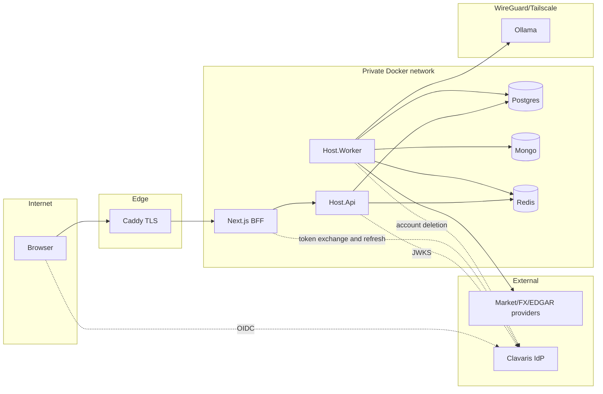

# Threat model v1 (STRIDE)

- **Purpose:** identify threats per trust boundary and track mitigations. Updated every phase.
- **Owner:** Eder · **Status:** approved · **Target phase:** 0 (updated each phase)

## Data-flow diagram

Trust boundaries: TB1 browser↔edge, TB2 edge↔app, TB3 app↔datastores, TB4 app↔LLM, TB5 app↔external providers/IdP.

## STRIDE
| ID | Boundary | Threat | Mitigation | Status |
|---|---|---|---|---|
| T1 | TB1 | **S**poofing: forged/replayed JWT | JWKS validation, alg allow-list, iss/exp/nbf, short skew, audience check once confirmed (clavaris-contract.md) | planned P1 |
| T2 | TB1 | **T**ampering: mass assignment / injected ticker | FluentValidation, strict binding, ticker allow-list | planned P1 |
| T3 | TB2 | **R**epudiation: untraceable security events | append-only `platform.audit_log`, correlation id | planned P1 |
| T4 | TB3 | **I**nfo disclosure: cross-user data read (IDOR) | EF filters + Postgres RLS, tests with filter bypassed | planned P1 |
| T5 | TB1 | **D**oS on analysis trigger | per-user/IP rate limit, idempotency, concurrency limiter | planned P1/P4 |
| T6 | TB3 | **E**levation: API role over-privileged | `api_role`/`worker_role` least privilege | planned P1 |
| T7 | TB4 | Prompt injection via filings/news | untrusted-data delimiting, no tools, schema-validated output, deterministic signal | planned P4 |
| T8 | TB5 | SSRF via user URLs | no user-controlled URLs; named HttpClients with host allow-lists | planned P2 |
| T9 | TB3 | Secrets leakage in repo/logs | gitleaks, redaction policy, Docker secrets | planned P0/P1 |
| T10 | repo | Poisoned dev tooling and build configuration (hooks, scripts, CI) | CODEOWNERS (`RedeArmy`), CI scan, vetted tooling configuration, read-only dev DB | partial P0 |
| T11 | supply chain | Malicious dependency/image | Dependabot, CodeQL, Trivy, SBOM; digest pins P5 | planned P0/P5 |
| T12 | TB1 | Token theft via XSS | BFF httpOnly cookies, strict CSP | planned P3 |
| T13 | tooling | Dev tooling self-modifies its guardrails or abuses allow-listed executors (`make`, scripts) | write guards on protected paths, review on build/CI files, narrowed allow-lists, CODEOWNERS | partial P0 |
| T14 | CI/CD | Mutable action tags; unprotected `main` | Actions pinned to commit SHAs (done); branch protection with required checks and no force push (code-owner review not required: solo developer, A-015) | partial P0 |
| T15 | TB3 | Dev superuser makes RLS tests vacuous | `api_role`/`worker_role` NOSUPERUSER NOBYPASSRLS; test asserts `is_superuser=off` (A-014) | planned P1 |
| T16 | TB4 | LLM cost/DoS, cross-tenant prompt/cache leakage, transport auth over Tailscale | token/budget quotas, no per-user data in shared prompts, service token + key rotation | planned P4 |
| T17 | TB1 | CSRF / session fixation / open redirect in BFF OIDC callback | SameSite cookies, state+nonce+PKCE, redirect allow-list | planned P3 |
| T18 | dev | Fake IdP reachable outside dev | compose `dev` profile only; CI check that deployed compose lacks it | planned P5 |
| T19 | TB3 | Redis queue poisoning / idempotency-key collision across tenants | Redis auth + private network; keys scoped by `user_id` (ADR-0005) | planned P1 |
| T20 | TB3 | Mongo has no RLS equivalent: cross-tenant reads | Mongo holds only shared (non-user) data by design; per-db app user | planned P1 |
| T21 | TB5 | Platform-tier Clavaris credential in the Worker (needed for identity deletion) could be abused to delete other accounts | dedicated least-privilege PlatformClient, Worker-only secret, egress limited to the Clavaris host, per-call audit, rotation runbook, job accepts only ids from our tombstones | planned P6 |
| T22 | telemetry | Secrets or personal data leak into logs, traces or metrics, or the telemetry stack is reachable from outside | `RedactionEnricher` last in the Serilog chain (tests), Collector deletes `Authorization`/`Cookie`/query attributes, low-cardinality labels, stack on an internal network with Grafana and OTLP published on loopback only and Grafana admin password required (ADR-0016) | mitigated P1 (dev); deployed sizing and access in P5 |
