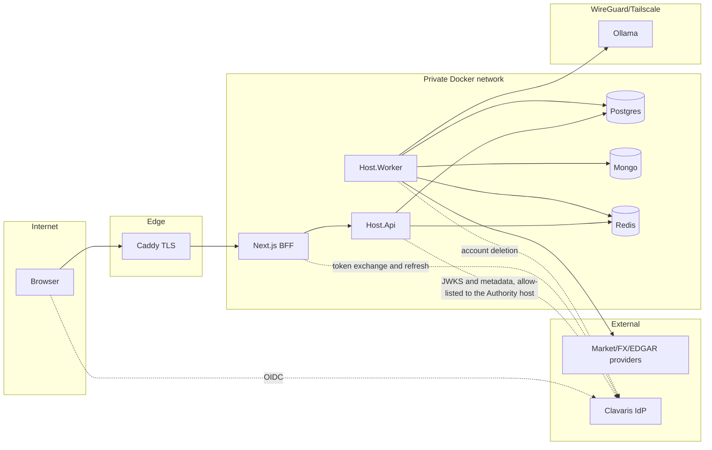

# Threat model v1 (STRIDE)

- **Purpose:** identify threats per trust boundary and track mitigations. Updated every phase.
- **Owner:** Eder · **Status:** approved · **Target phase:** 0 (updated each phase)

## Data-flow diagram

Trust boundaries: TB1 browser↔edge, TB2 edge↔app, TB3 app↔datastores, TB4 app↔LLM, TB5 app↔external providers/IdP.

## STRIDE
| ID | Boundary | Threat | Mitigation | Status |
|---|---|---|---|---|
| T1 | TB1 | **S**poofing: forged/replayed JWT | RS256 only (checked before any key lookup), signing keys from the discovered JWKS, exact issuer, required audience, lifetime with injected clock and skew capped at 60 s, ID tokens and `act` tokens refused (T24), token length cap; unknown `kid` triggers one awaited refresh per 30 s; when the provider is unreachable the last known keys are served for at most `MaximumKeyAge` (24 h) and then validation fails closed, so a provider outage is neither a lock-out nor an unbounded trust in a withdrawn key (event 9603) | mitigated P1 |
| T2 | TB1 | **T**ampering: mass assignment / injected ticker | Validators on every command (locale allow-list, key format), strict binding, body cap (T27); ticker allow-list arrives with the watchlist | partial P1; P2 |
| T3 | TB2 | **R**epudiation: untraceable security events | Append-only `platform.audit_log` (triggers reject UPDATE/DELETE/TRUNCATE), hash chain verified by `verify_audit_chain`, actor stored as an HMAC pseudonym, entry written in the same transaction as the change, correlation id. The chain is tamper-evident, not tamper-proof: the table owner or a superuser can disable the triggers, and truncating the tail is undetectable without an external anchor (the head hash and count are not yet recorded outside the database; planned P5) | mitigated P1; anchor P5 |
| T4 | TB3 | **I**nfo disclosure: cross-user data read (IDOR) | Postgres RLS on user-owned tables keyed on `app.current_user_id` (set from the validated principal on every connection open; empty means no rows), minimal grants, isolation tests; the user id never comes from client input. RLS is `ENABLE` without `FORCE` by design: the runtime roles own no tables and the security-definer functions run as the owner | mitigated P1 |
| T5 | TB1 | **D**oS on analysis trigger or on the API in general | Two limiters: per client IP before authentication (an IPv6 client is counted by its /64, so rotating addresses inside it buys no new allowance; `PreAuthenticationPermitLimit`, so floods of missing or invalid tokens are limited before any signature is validated) and per user after authentication (`PermitLimit`, `ExpensivePermitLimit`); idempotency; the analysis concurrency limiter arrives in P4. Health endpoints are exempt (T30) | mitigated P1; P4 for analysis |
| T6 | TB3 | **E**levation: API role over-privileged | `api_role`/`worker_role` are NOLOGIN NOSUPERUSER NOBYPASSRLS group roles; `REVOKE ALL ... FROM PUBLIC` then minimal grants (the API has no access to the queue, the inbox or `audit_log`; the worker has no access to `identity`); security-definer functions pin `search_path` and revoke `PUBLIC`, tested. Residual risk for a compromised `api_role` is listed in T31 | mitigated P1 |
| T7 | TB4 | Prompt injection via filings/news | untrusted-data delimiting, no tools, schema-validated output, deterministic signal | planned P4 |
| T8 | TB5 | SSRF via user URLs | no user-controlled URLs; named HttpClients with host allow-lists (a host name allows only the default port of the scheme; another port needs an explicit `host:port` entry) | planned P2 |
| T9 | TB3 | Secrets leakage in repo/logs | gitleaks (pre-commit and CI), redaction policy and enricher (T22), secrets only through environment. Exception messages are not scrubbed (only log properties), so an exception that embeds a secret or personal data would reach the log; no `ShowPII`, and connection strings are never put in exception text by our code | mitigated P1; exception scrubbing backlog |
| T10 | repo | Poisoned dev tooling and build configuration (hooks, scripts, CI) | CODEOWNERS (`RedeArmy`), CI scan, vetted tooling configuration, read-only dev DB | partial P0 |
| T11 | supply chain | Malicious dependency/image | Dependabot, CodeQL, Trivy, SBOM; digest pins P5 | planned P0/P5 |
| T12 | TB1 | Token theft via XSS | BFF httpOnly cookies, strict CSP | planned P3 |
| T13 | tooling | Dev tooling self-modifies its guardrails or abuses allow-listed executors (`make`, scripts) | write guards on protected paths, review on build/CI files, narrowed allow-lists, CODEOWNERS | partial P0 |
| T14 | CI/CD | Mutable action tags; unprotected `main` | Actions pinned to commit SHAs (done); branch protection with required checks and no force push (code-owner review not required: solo developer, A-015) | partial P0 |
| T15 | TB3 | Dev superuser makes RLS tests vacuous | `api_role`/`worker_role` NOSUPERUSER NOBYPASSRLS; test asserts `is_superuser=off` (A-014) | mitigated P1 |
| T16 | TB4 | LLM cost/DoS, cross-tenant prompt/cache leakage, transport auth over Tailscale | token/budget quotas, no per-user data in shared prompts, service token + key rotation | planned P4 |
| T17 | TB1 | CSRF / session fixation / open redirect in BFF OIDC callback | SameSite cookies, state+nonce+PKCE, redirect allow-list | planned P3 |
| T18 | dev | Fake IdP reachable outside dev | compose `dev` profile only; CI check that deployed compose lacks it | planned P5 |
| T19 | TB3 | Redis queue poisoning / idempotency-key collision across tenants | Idempotency and the job queue live in PostgreSQL (ADR-0022), keys scoped by user, method and route template; Redis (auth, private network) holds only cache and sessions from P2/P3 | mitigated P1 |
| T20 | TB3 | Mongo has no RLS equivalent: cross-tenant reads | Mongo holds only shared (non-user) data by design; collections created with strict `$jsonSchema` validators; per-db app user at deployment | partial P1; deployment P5 |
| T21 | TB5 | Platform-tier Clavaris credential in the Worker (needed for identity deletion) could be abused to delete other accounts | dedicated least-privilege PlatformClient, Worker-only secret, egress limited to the Clavaris host, per-call audit, rotation runbook, job accepts only ids from our tombstones | planned P6 |
| T22 | telemetry | Secrets or personal data leak into logs, traces or metrics, or the telemetry stack is reachable from outside | `RedactionEnricher` last in the Serilog chain (tests), Collector deletes `Authorization`/`Cookie`/query attributes, low-cardinality labels, stack on an internal network with Grafana and OTLP published on loopback only and Grafana admin password required (ADR-0016) | mitigated P1 (dev); deployed sizing and access in P5 |
| T23 | authorization | A caller reads or changes another user's data (broken object-level authorization), or an endpoint ships without any authorization | Default-deny fallback policy (only health is anonymous), ownership handler, foreign resources answered `404` not `403`, row-level security as second line, authorization matrix tests (ADR-0009) | mitigated P1 |
| T24 | authentication | An ID token (same key and audience as the access token) or an operator impersonation token (`act`) is presented as an access token | The provider requires the `scope` claim (ID tokens have none) and refuses `act`; verified live against Clavaris: the ID token was accepted before the fix (reason `NotAnAccessToken`) | mitigated P1 |
| T25 | outbound HTTP | An allowed host answers with a redirect to an internal or unlisted host and the client follows it below the host allow-list | Named clients never follow redirects (`AllowAutoRedirect = false`); regression test against a real Kestrel | mitigated P1 |
| T26 | api description | The OpenAPI document or Swagger UI discloses the API surface to anyone | Anonymous only in Development or with `OpenApi:Anonymous`; otherwise a valid token; Swagger UI only in Development; the document carries no server URL or secrets; tested for Production | mitigated P1 |
| T27 | edge | A caller spoofs its IP through `X-Forwarded-For` to evade the per-IP rate limit, frames or sniffs responses, reads responses cross-origin, or sends oversized bodies | Forwarded headers trusted only from configured proxies, one hop; the pre-authentication limiter partitions by that address (T5); security headers and `no-store` on every response; CORS closed by default with an exact-origin allow-list; HSTS outside Development; 1 MiB body cap; all tested | mitigated P1; proxy network to configure at deployment (A-023) |
| T28 | retention | A retention run deletes data that is still needed (wrong cutoff, unprocessed events, live keys) or locks tables for long | Dry run is the default and a job payload can ask for a dry run but never switch one off (the configured default wins, tested), so a forged `retention.run.v1` enqueued through `enqueue_job` cannot start deleting; only finished rows qualify; bounded batches and batch count; `SKIP LOCKED` where the role may lock; the worker reaches idempotency keys only through two security-definer functions; tested on real PostgreSQL incl. concurrent runs. The whole run is one transaction, acceptable for the small platform tables | mitigated P1 |
| T29 | authentication | Just-in-time provisioning gives an account to any holder of a valid Clavaris token of the Organization; email and display name come from unverified claims; a token's `locale` claim is stored | Identity is linked by issuer plus subject only (never by email); audience and `scope` are required; email and name are display data; `provision_user` is the only write path of the API into `identity.users`. Not yet required: an application-specific scope (Clavaris defines none today) and normalizing the stored locale to the supported list | accepted P1; scope and locale in P2 |
| T30 | availability | `/health/ready` is anonymous and unthrottled and reports PostgreSQL, MongoDB and Redis checks; `/health/live` is unauthenticated by design | The checks run at most once per `Health:ReadinessCacheSeconds` (5 s) however many probes arrive, so the endpoint costs one query per datastore per window, not one per request; responses are status only (no check names or exception text); exposure beyond the internal network is a deployment decision: only the proxy should reach `/health/ready`, and the production Caddyfile must not publish it (P5) | accepted P1; deployment P5 |
| T31 | TB3 | A compromised `api_role` (SQL execution as the API login) abuses what it may legitimately call | `provision_user` (security definer, bypasses RLS) can refresh the display data of any active user and return its id; `append_audit` accepts any actor and event type, so entries can be forged; the audit advisory lock can be held to block audit writes; `UPDATE` on `identity.users` is table-wide. All require code execution inside the API's database session, which RLS and the other mitigations do not defend against. Backlog: column-level UPDATE on `identity.users`, restricting job types `enqueue_job` accepts, an off-database audit anchor (T3) | accepted P1; hardening in P2 backlog |
| T32 | account state | A deleted or suspended account keeps working for a few minutes because its resolution is cached | `ResolvedUserCache` trusts a mapping for 5 minutes per API instance and refuses accounts in deletion once it expires; deletion itself arrives in P6, where the cache is invalidated on state change | accepted P1; P6 |
| T33 | TB5 | Unauthenticated callers abuse the key refresh to hammer the identity provider, or an outage of the provider locks everyone out | Refresh for an unknown `kid` is rate limited (one per 30 s) and awaited; failed fetches are not retried on every request; stale keys are served up to `MaximumKeyAge` during an outage (T1); the pre-authentication limiter (T5) bounds the request rate that can reach this path | mitigated P1 |
| T34 | privacy | Personal data outlives its purpose: `idempotency_keys.response_body` stores the first response of a retried command, which can hold the profile (email, display name), and retention starts in dry-run mode | Keys expire after `Idempotency:Retention` (48 h) and the daily retention run removes them once `Retention:DryRun` is switched off; the worker logs event 9705 at every start outside Development while dry run is on; `platform.purge_user_idempotency_keys(user_id)` lets the account-deletion saga remove a user's keys at once (wired in Phase 6); the same applies to any new table that stores a user's responses or events | mitigated P1; deletion wiring P6 |
| T35 | secrets in text | A driver or provider quotes a credential or an email in an exception message, and that text lands in a log line or in `last_error` of a failed job or outbox message, which operators read and paste into tickets | `SensitiveText` (Kernel) masks JWTs, `Bearer`/`Basic` credentials and `name=value` pairs for secret-looking names; logs use it for every string, and `last_error` also masks emails, is one line and is cut to 500 characters; the scrubber has a match timeout and masks the whole text if it trips | mitigated P1 |
